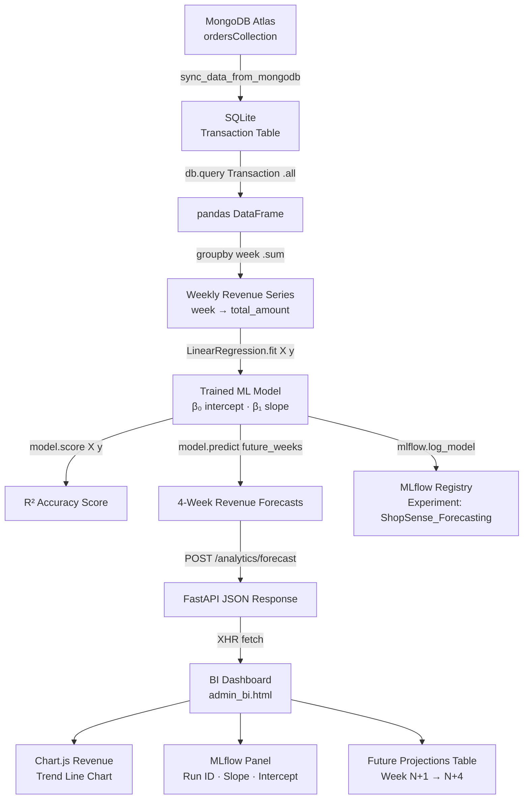
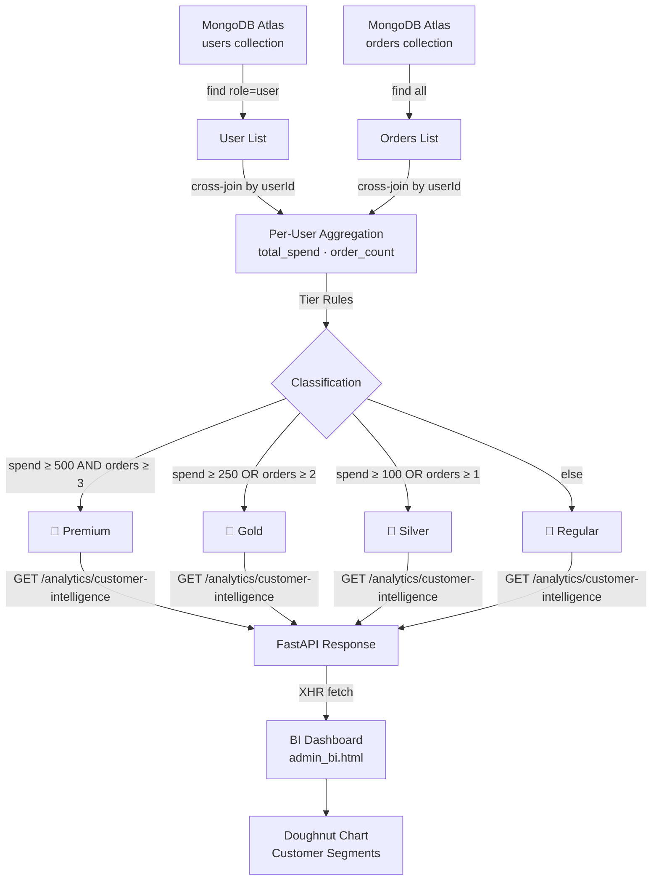

# ShopSense – System Architecture Reference
> Full architecture documentation for the ShopSense analytics platform.

---

## System Overview

ShopSense is a **three-tier analytics platform** consisting of:
1. **Frontend** – Vanilla HTML/CSS/JS dashboards served by Express static middleware
2. **Node.js Express Backend** – E-commerce API layer (auth, orders, products, vendors)
3. **Python FastAPI Analytics Engine** – ML forecasting, RFM segmentation, revenue intelligence

All data originates from **MongoDB Atlas** (cloud) and is synchronized to **SQLite** for efficient analytical queries.

---

## High-Level Architecture Diagram

```
┌─────────────────────────────────────────────────────────────────────┐
│                         BROWSER (Client)                            │
│  frontend/pages/*.html + frontend/js/*.js + frontend/css/*.css      │
└───────────────┬─────────────────────────────────┬───────────────────┘
                │ HTTP :5000                       │ HTTP :8000
                ▼                                 ▼
┌───────────────────────────┐     ┌───────────────────────────────────┐
│  Node.js Express Backend  │     │  Python FastAPI Analytics Engine   │
│  (backend/server.js)      │     │  (backend/python_app/app/main.py)  │
│                           │     │                                    │
│  • Auth / JWT Login       │     │  • Revenue Analytics               │
│  • Product Catalog        │     │  • ML Forecasting (LinearReg)      │
│  • Order Processing       │     │  • RFM Customer Intelligence       │
│  • Vendor Registration    │     │  • MongoDB → SQLite Sync           │
│  • Static File Serving    │     │  • MLflow Experiment Tracking      │
└───────────┬───────────────┘     └──────────────┬─────────────────────┘
            │                                    │
            │ mongoose                           │ pymongo + sqlalchemy
            ▼                                   ▼
┌───────────────────────┐        ┌─────────────────────────────────────┐
│   MongoDB Atlas       │        │   SQLite (shopsense.db)             │
│   (Cloud Database)    │◄───────│   Synchronized replica for ML       │
│                       │  sync  │                                     │
│  Collections:         │        │  Tables:                            │
│  • users              │        │  • vendors                          │
│  • vendors            │        │  • products                         │
│  • products           │        │  • transactions                     │
│  • orders             │        └──────────────┬──────────────────────┘
│  • inventory          │                       │
└───────────────────────┘                       │ model.fit(X, y)
                                                ▼
                                ┌───────────────────────────────────┐
                                │  scikit-learn LinearRegression    │
                                │  (controllers/forecasting.py)     │
                                │                                   │
                                │  Input:  Weekly revenue groups    │
                                │  Output: 4-week projections       │
                                │  Metric: R² accuracy score        │
                                └──────────────┬────────────────────┘
                                               │ mlflow.log_*()
                                               ▼
                                ┌──────────────────────────────┐
                                │  MLflow Tracking Server      │
                                │  (sqlite:///mlflow.db)       │
                                │                              │
                                │  • Run ID (UUID)             │
                                │  • Intercept (β₀)            │
                                │  • Slope (β₁)                │
                                │  • Accuracy (R²)             │
                                │  • Serialized model artifact │
                                └──────────────────────────────┘
```

---

## Data Flow Diagram – ML Forecasting Pipeline



---

## Data Flow Diagram – Customer RFM Intelligence



---

## Database Schema

### MongoDB Atlas Collections

**users**
```json
{ "_id": ObjectId, "name": str, "email": str, "password": hashed,
  "role": "user|admin|vendor", "rewardPoints": int }
```

**vendors**
```json
{ "_id": ObjectId, "shopName": str, "ownerName": str, "email": str,
  "phone": str, "businessType": str, "password": hashed }
```

**products**
```json
{ "_id": ObjectId, "productName": str, "category": str, "price": float,
  "stock": int, "vendorId": ObjectId, "imageUrl": str }
```

**orders**
```json
{ "_id": ObjectId, "userId": ObjectId, "products": [{"productId": ObjectId,
  "quantity": int, "price": float}], "totalAmount": float,
  "orderDate": ISODate, "status": str }
```

### SQLite Analytical Tables (synced from MongoDB)

| Table | Columns | Purpose |
|---|---|---|
| `vendors` | id, business_name, owner_name, email, phone, business_type | Vendor reference for joins |
| `products` | id, name, category, price, quantity, vendor_id | Product reference for revenue attribution |
| `transactions` | id, vendor_id, total_amount, date | Aggregated order amounts per vendor |

---

## API Surface Summary

### Node.js Express (Port 5000)
| Method | Route | Description |
|---|---|---|
| POST | `/api/auth/login` | Admin/user login (JWT) |
| GET | `/api/products` | Product catalog |
| POST | `/api/products` | Add product (vendor auth) |
| GET | `/api/orders` | All orders (admin) |
| POST | `/api/orders` | Place an order |
| GET | `/api/vendors` | All vendors (admin) |
| POST | `/api/vendors` | Register new vendor |
| GET | `/api/analytics` | Revenue metrics (Express) |

### Python FastAPI (Port 8000)
| Method | Route | Description |
|---|---|---|
| GET | `/` | Health check & endpoint listing |
| GET | `/vendors/` | Vendor list from SQLite |
| GET | `/vendors/ranking` | ML-ranked vendor performance |
| GET | `/analytics/revenue` | GMV & profit aggregations |
| POST | `/analytics/forecast` | Train ML model & get forecasts |
| GET | `/analytics/customer-intelligence` | RFM tier segmentation |
| POST | `/analytics/sync` | Trigger MongoDB → SQLite sync |

---

## Security Considerations

| Layer | Mechanism |
|---|---|
| Authentication | JWT tokens signed with `JWT_SECRET` env variable |
| CORS | FastAPI CORSMiddleware allows `*` (restrict to domain in production) |
| Secrets | `.env` file — never committed to Git (add to `.gitignore`) |
| Docker | Non-root user `shopsense` in both container images |
| Passwords | bcrypt hashing via Mongoose `pre-save` hook |
